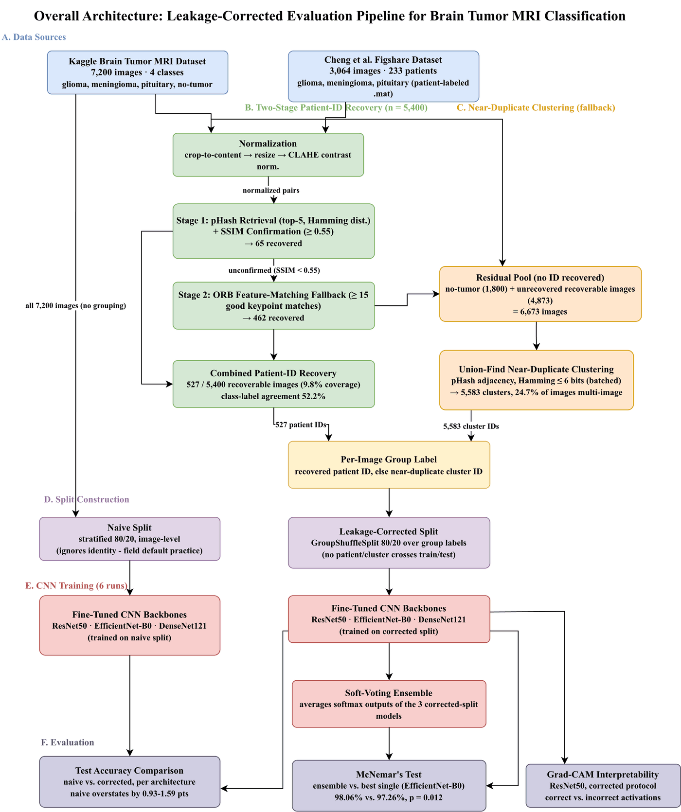

**🏆 Second Best Paper Award, IEEE i-COSTE 2026 (Cox's Bazar, Bangladesh).**

The most used brain tumor MRI benchmark pools images from several sources without patient IDs, so near-identical slices from one scan can leak between training and test sets. We recover patient IDs where possible, build a leakage-corrected split, and show that naive image-level splits overstate accuracy by 0.93–1.59 points for three common CNNs. On the corrected split, a soft-voting ensemble is significantly better than the best single model.

[Read more about this research](/research/mri-leakage-audit)
