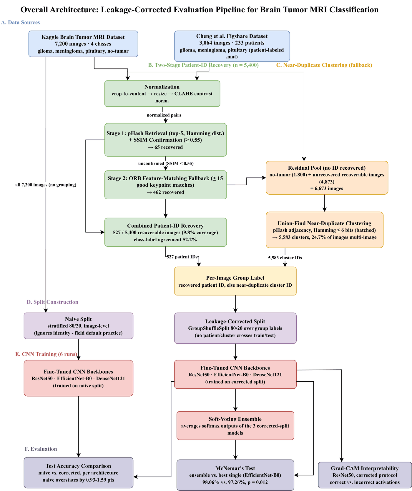

The Kaggle Brain Tumor MRI Dataset is the most used benchmark for brain tumor classification, and recent papers report 93–99.9% accuracy on it. But the dataset pools images from several sources without patient IDs, so near-identical slices from one scan can end up in both training and test sets. None of the 25 recent studies we surveyed on this dataset checks for this.

* **Surveyed** 30 recent papers and found that 19 of the 25 studies on this dataset family use plain random image-level splits, and none verifies patient-level separation.
* **Recovered** real patient IDs for 527 of 5,400 tumor images with a two-stage matching pipeline (perceptual hashing with SSIM, then ORB feature matching) against the patient-labeled Figshare source, and reported openly how unreliable the fallback matches are.
* **Built** a leakage-corrected, group-aware split of all 7,200 images by combining the recovered IDs with near-duplicate clustering. Under this grouping, 28.6% of the naive test images have a near-twin in the training set.
* **Showed** that naive splits overstate accuracy by 0.93–1.59 points for ResNet50, EfficientNet-B0 and DenseNet121, a lower bound since most of the correction is clustering-based.
* **Found** that a conclusion about a method can depend on the split: a soft-voting ensemble is significantly better than the best single model on the corrected split (98.06% vs. 97.26%, McNemar p = 0.012).
* **Recommended** that studies on pooled MRI data state their split unit, release group-aware splits, and report how reliable any identity matching is.

[View the publication](/publication/2026-11-01-mri-leakage-audit)
